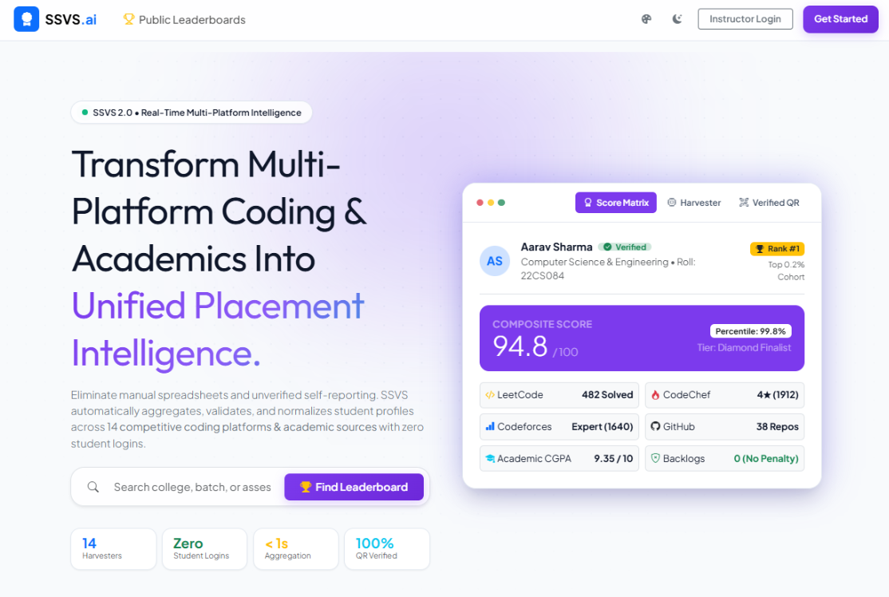
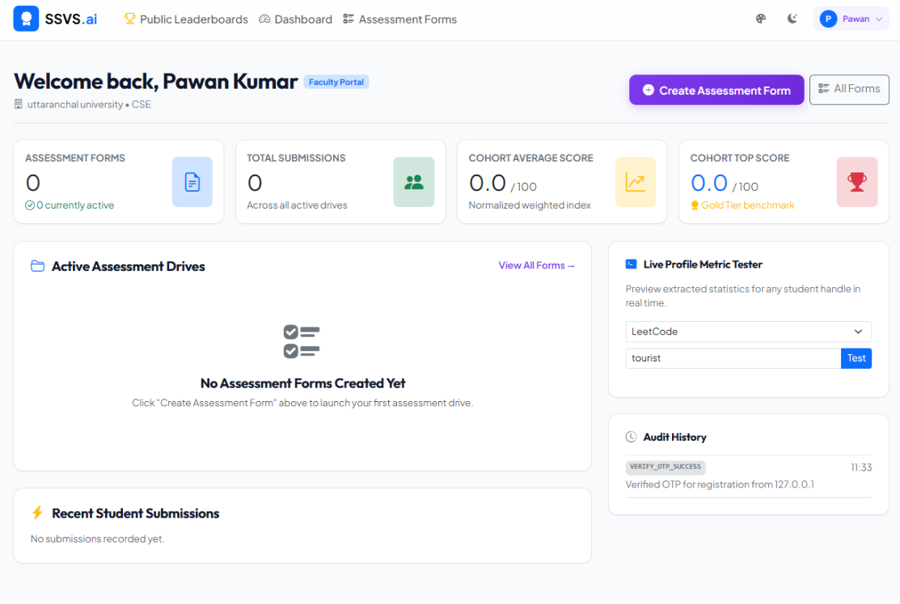
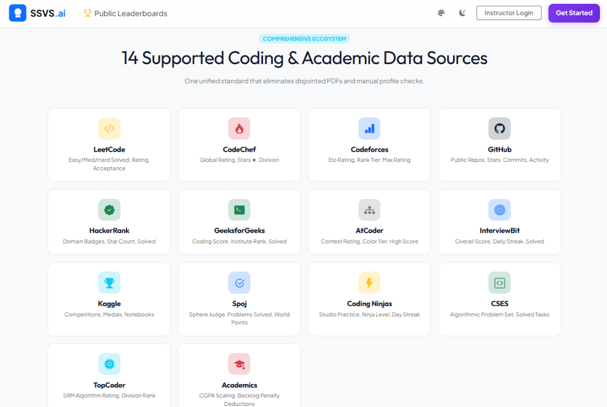
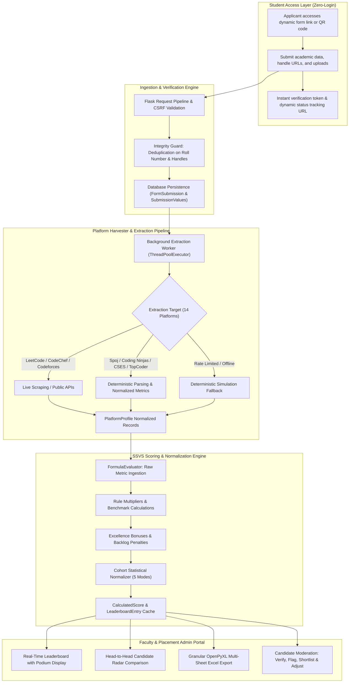

# Student Score View System (SSVS)

SSVS is an enterprise academic assessment and student competitive programming evaluation system engineered with Python, Flask, SQLAlchemy, Jinja2, Bootstrap 5, Chart.js, and OpenPyXL.

SSVS empowers educational institutions, university placement departments, and hackathon review panels to build dynamic forms, collect candidate competitive programming handles, extract real-time metrics across 14 platforms, compute normalized performance scores using customizable mathematical formulas, visualize live cohort leaderboards, and produce multi-sheet analytical Excel reports.

---

## 1. Project Title, Overview & Mission

The **Student Score View System (SSVS)** addresses the challenge of holistic engineering student evaluation. Traditional manual verification of student coding credentials across multiple online judges is time-consuming, prone to data entry errors, and vulnerable to handle impersonation.

SSVS delivers an automated evaluation pipeline:
- **Zero-Friction Access**: Students submit verified handles without credential creation or login friction.
- **Multi-Platform Scraping & Simulation**: Automated extraction across 14 competitive coding, problem-solving, and version-control platforms.
- **Configurable Scoring Engine**: Granular formula builder supporting benchmarks, excellence bonuses, backlog penalty deductions, and letter grade brackets.
- **Statistical Normalization**: Five cohort-level statistical normalization algorithms (Min-Max, Cohort Min-Max, Z-Score, Percentile, Weighted Sum).
- **Administrative Governance**: Complete teacher workflow with audit trails, duplicate handle warnings, candidate comparison radars, and custom Excel exports.

---

## 2. Visual Interface & Production Showcase

The following production screenshots highlight the core interface experiences across student discovery, automated multi-platform extraction, and faculty administration.

### 2.1. Enterprise Landing Page & Candidate Placement Matrix
Transforming multi-platform competitive coding and academic performance into unified placement intelligence with composite scoring, percentile ranking, and instant leaderboard search.

<p align="center">
  
</p>

### 2.2. Comprehensive 14-Platform Harvester Ecosystem
Unified extraction pipeline spanning 14 competitive coding, problem-solving, and version-control platforms with automated fallbacks and zero student logins.

<p align="center">
  
</p>

### 2.3. Faculty Administration & Live Moderation Studio
Personalized instructor cockpit featuring active assessment drives, live handle metric testing (e.g. LeetCode, Codeforces), and real-time audit logs.

<p align="center">
  
</p>

---

## 3. Live Demonstrations & Public Endpoints

The complete application is accessible via the production deployment:

- **Live Application Deployment (Frontend & Backend)**: [https://ssvsportal.onrender.com](https://ssvsportal.onrender.com)
- **Primary Web Service**: `https://ssvsportal.onrender.com`
- **Application Health Check Probe**: `https://ssvsportal.onrender.com/healthz`
- **Public Leaderboard Portal**: `https://ssvsportal.onrender.com/leaderboard`
- **Faculty Portal**: `https://ssvsportal.onrender.com/auth/login`

---

## 3. Lead Architect, Creator & Maintainer Profile

| Attribute | Details |
| :--- | :--- |
| **Lead Architect & Developer** | **Pawan Kumar** |
| **Personal Portfolio** | [pawankumar.info](https://pawankumar.info/) |
| **LinkedIn Profile** | [linkedin.com/in/pawankumar101](https://www.linkedin.com/in/pawankumar101/) |
| **LeetCode Profile** | [leetcode.com/u/pk3253702](https://leetcode.com/u/pk3253702/) |
| **GitHub Organization / Profile** | [github.com/POWER-WORLD](https://github.com/POWER-WORLD) |
| **Live Showcase** | [ssvs-portal.onrender.com](https://ssvsportal.onrender.com) |

---

## 4. Core Objectives & Academic Value Proposition

1. **Elimination of Credential Burden**: No account creation for applicants reduces drop-off rates during campus placement registrations.
2. **Standardized Objective Evaluation**: Multi-source metrics eliminate subjective bias by weighting competitive problem volume, contest rating, and version control activity.
3. **Plagiarism & Impersonation Mitigation**: Automated detection flags duplicate profile handles and duplicate roll numbers across candidate submissions.
4. **Institutional Reporting Readiness**: Formatted Excel export workbooks provide placement directors with multi-tab summaries, raw metric data, and ranking analytics.

---

## 5. System Architecture & End-to-End Data Pipeline

The following architectural flow illustrates the operational lifecycle of student submissions, background metric collection, scoring calculation, and faculty moderation:



---

## 6. Comprehensive Repository Directory Structure

```
d:/Agents/SSVS/
├── app/
│   ├── __init__.py                # Application factory (create_app) & extensions
│   ├── config.py                  # Environment-driven configuration (PostgreSQL / SQLite)
│   ├── public/                    # Showcase screenshots & static presentation media
│   │   └── screenshots/           # Application interface captures
│   ├── models/
│   │   ├── __init__.py            # SQLAlchemy db instance & model exports
│   │   ├── user.py                # Teacher authentication & account profile model
│   │   ├── form.py                # Form, FormField, and FieldOption models
│   │   ├── submission.py          # FormSubmission & SubmissionValue relational models
│   │   ├── platform_profile.py    # Multi-platform statistics persistence model
│   │   ├── scoring.py             # ScoreFormula, FormulaRule, CalculatedScore, LeaderboardEntry
│   │   └── audit.py               # ActivityLog model for administrative actions
│   ├── auth/                      # Faculty authentication blueprint (Login, Register, Reset)
│   │   ├── forms.py               # WTForms authentication schemas
│   │   └── routes.py              # Auth route handlers
│   ├── dashboard/                 # Faculty overview dashboard & metrics summary
│   │   └── routes.py              # Dashboard analytics & feed endpoints
│   ├── forms_mgr/                 # Visual form designer & form lifecycle controller
│   │   └── routes.py              # Form CRUD, builder API, and sharing routes
│   ├── student/                   # Zero-auth public student submission & status blueprint
│   │   └── routes.py              # Public forms, status checking, and public leaderboards
│   ├── scoring_engine/            # Mathematical evaluation & statistical normalizer
│   │   ├── formula_evaluator.py   # Core rule calculator & bonus/penalty evaluator
│   │   ├── normalizer.py          # Min-Max, Z-score, and percentile mathematical algorithms
│   │   ├── default_presets.py     # Evaluation templates for CP, Placements, and Data Science
│   │   └── README.md              # Dedicated mathematical engine documentation
│   ├── extractors/                # Platform extractors & deterministic simulation
│   │   ├── base.py                # Abstract base extractor and URL parser
│   │   ├── schema.py              # Standardized platform metric dataclasses
│   │   ├── leetcode.py            # LeetCode GraphQL extractor
│   │   ├── codechef.py            # CodeChef profile scraper
│   │   ├── codeforces.py          # Codeforces public API extractor
│   │   ├── github.py              # GitHub public API extractor
│   │   ├── hackerrank.py          # HackerRank profile extractor
│   │   ├── geeksforgeeks.py       # GeeksforGeeks profile scraper
│   │   ├── atcoder.py             # AtCoder contest scraper
│   │   ├── interviewbit.py        # InterviewBit score parser
│   │   ├── kaggle.py              # Kaggle data science extractor
│   │   ├── spoj.py                # Sphere Online Judge extractor
│   │   ├── codingninjas.py        # Coding Ninjas (Studio) extractor
│   │   ├── cses.py                # CSES Problem Set extractor
│   │   ├── topcoder.py            # TopCoder competitive extractor
│   │   └── mock_simulator.py      # Deterministic profile generator for offline/testing
│   ├── analytics/                 # Visual analytics & candidate comparison radar
│   │   └── routes.py              # Analytics routes and Chart.js endpoints
│   ├── export/                    # High-fidelity multi-sheet Excel generator
│   │   └── excel_exporter.py      # OpenPyXL workbook architect
│   ├── api/                       # Internal JSON API endpoints for AJAX & builder autosave
│   │   └── routes.py              # REST API controllers
│   ├── utils/                     # Cross-cutting application utilities
│   │   ├── background.py          # ThreadPoolExecutor asynchronous task worker
│   │   ├── email_service.py       # Google Apps Script Email Gateway & OTP delivery
│   │   ├── qrcode_gen.py          # Dynamic QR code generation for public forms
│   │   └── security.py            # Sanitization, masking, and security headers
│   ├── static/                    # Front-end design system & client scripts
│   │   ├── css/ssvs-theme.css     # Unified CSS design variables & dark/light theme
│   │   └── js/
│   │       ├── app.js             # Theme switcher & global UI helpers
│   │       ├── form-builder.js    # Drag-and-drop form designer with palette
│   │       ├── student-form.js    # Client-side validation & dynamic input handling
│   │       └── submission-tracker.js # Real-time AJAX polling for status updates
│   └── templates/                 # Jinja2 presentation templates
│       ├── base.html              # Core layout template with developer profile links
│       ├── landing.html           # Enterprise homepage with architect showcase card
│       ├── auth/                  # Authentication views (login, register, forgot)
│       ├── dashboard/             # Overview dashboard
│       ├── forms/                 # Form builder, listing, QR sharing
│       ├── scoring/               # Formula studio interface
│       ├── submissions/           # Moderation queue, candidate detail, side-by-side radar
│       ├── leaderboard/           # Public & institutional leaderboards
│       ├── student/               # Zero-login form viewer & status receipt
│       └── errors/                # Standardized error pages (403, 404, 500)
├── .env.example                   # Configuration environment template
├── requirements.txt               # Pinned production dependencies
├── render.yaml                    # Render Cloud 1-click blueprint specification
├── wsgi.py                        # Production WSGI gateway entry point
└── run.py                         # Local development execution runner
```

---

## 7. Technical Stack Specification

| Tier / Category | Technology | Version | Purpose & Architecture Role |
| :--- | :--- | :--- | :--- |
| **Language Runtime** | Python | 3.13 / 3.11+ | Primary execution environment |
| **Web Framework** | Flask | 3.1.0 | Application core & Blueprint architecture |
| **ORM / Data Layer** | SQLAlchemy / Flask-SQLAlchemy | 3.1.1 | Relational database mapping & connection pooling |
| **Database Engines** | PostgreSQL / SQLite | v16+ / v3 | Production cloud storage (Neon) & local development |
| **Authentication** | Flask-Login / Werkzeug | 0.6.3 / 3.1 | Faculty session management & PBKDF2:SHA256 password hashing |
| **Form Management** | Flask-WTF / WTForms | 1.3.0 / 3.2 | Server-side validation, CSRF token generation |
| **Schema Validation** | Pydantic | 2.13+ | Platform extraction payload validation |
| **UI Framework** | Bootstrap | 5.3.3 | Responsive grid layout, accessibility components |
| **Data Visualization** | Chart.js | 4.4.1 | Head-to-head radar charts, score distribution charts |
| **Reporting Engine** | OpenPyXL | 3.1.5 | Multi-tab formatted Excel reporting with frozen headers |
| **HTML Parsing** | BeautifulSoup4 / Soupsieve | 4.13.3 | Platform scraper parsing |
| **HTTP Client** | Requests / Urllib3 | 2.32.3 | External platform extraction & API integration |
| **QR Code Engine** | Segno / QRCode / Pillow | Latest | In-memory QR code generation for forms |
| **WSGI Server** | Gunicorn | 23.0.0 | Production HTTP process manager |
| **Static Assets** | WhiteNoise | 6.8.2 | Direct WSGI static file compression & caching |

---

## 8. Supported 14-Platform Extraction Matrix

SSVS supports 14 distinct platforms and evaluation dimensions. Each platform extractor features defensive parsing, standardized metric outputs, and deterministic fallbacks.

<p align="center">
  
</p>

| # | Platform / Dimension | Primary Metrics Extracted | URL Syntax & Patterns | Extractor File |
| :---: | :--- | :--- | :--- | :--- |
| 1 | **LeetCode** | Problems Solved (Total, Easy, Medium, Hard), Contest Rating, Global Ranking, Acceptance Rate | `leetcode.com/u/<username>`<br>`leetcode.com/<username>` | [`app/extractors/leetcode.py`](file:///d:/Agents/SSVS/app/extractors/leetcode.py) |
| 2 | **CodeChef** | Global Star Rating (1★–7★), Current Rating, Highest Rating, Total Solved Problems, Global Rank | `codechef.com/users/<username>` | [`app/extractors/codechef.py`](file:///d:/Agents/SSVS/app/extractors/codechef.py) |
| 3 | **Codeforces** | Contest Rating, User Rank Tier (Candidate Master, etc.), Max Rating, Solved Problems | `codeforces.com/profile/<username>` | [`app/extractors/codeforces.py`](file:///d:/Agents/SSVS/app/extractors/codeforces.py) |
| 4 | **GitHub** | Public Repositories, Total Star Count, Followers, Public Commits / Contributions | `github.com/<username>` | [`app/extractors/github.py`](file:///d:/Agents/SSVS/app/extractors/github.py) |
| 5 | **HackerRank** | Badges Count, Problem Solved Count, Verified Skill Stars | `hackerrank.com/profile/<username>`<br>`hackerrank.com/<username>` | [`app/extractors/hackerrank.py`](file:///d:/Agents/SSVS/app/extractors/hackerrank.py) |
| 6 | **GeeksforGeeks** | Coding Score, Total Problems Solved, Monthly Ranking | `geeksforgeeks.org/user/<username>` | [`app/extractors/geeksforgeeks.py`](file:///d:/Agents/SSVS/app/extractors/geeksforgeeks.py) |
| 7 | **AtCoder** | Rating, Highest Rating, User Tier Rank, Competitions Participated | `atcoder.jp/users/<username>` | [`app/extractors/atcoder.py`](file:///d:/Agents/SSVS/app/extractors/atcoder.py) |
| 8 | **InterviewBit** | Overall Score, Streak Days, Global Rank, Solved Count | `interviewbit.com/profile/<username>` | [`app/extractors/interviewbit.py`](file:///d:/Agents/SSVS/app/extractors/interviewbit.py) |
| 9 | **Kaggle** | Tier (Grandmaster, Master, Expert), Medals Count (Gold, Silver, Bronze), Notebooks Count | `kaggle.com/<username>` | [`app/extractors/kaggle.py`](file:///d:/Agents/SSVS/app/extractors/kaggle.py) |
| 10 | **Spoj** | Sphere Online Judge Solved Problems, World Rank, Total Points Earned | `spoj.com/users/<username>` | [`app/extractors/spoj.py`](file:///d:/Agents/SSVS/app/extractors/spoj.py) |
| 11 | **Coding Ninjas** | Total Solved Problems, Ninja Level, Overall Practice Points | `codingninjas.com/studio/profile/<username>` | [`app/extractors/codingninjas.py`](file:///d:/Agents/SSVS/app/extractors/codingninjas.py) |
| 12 | **CSES** | Solved Tasks Count (out of 300+ problem set), Completion Percentage | `cses.fi/user/<username>` | [`app/extractors/cses.py`](file:///d:/Agents/SSVS/app/extractors/cses.py) |
| 13 | **TopCoder** | Algorithm Rating, Highest Rating, Competition Matches Played | `topcoder.com/members/<username>` | [`app/extractors/topcoder.py`](file:///d:/Agents/SSVS/app/extractors/topcoder.py) |
| 14 | **Academic & Custom** | Academic CGPA (0.0–10.0 scale), Active Backlogs Count, University Roll Number, Resume Upload | Configurable form builder fields | [`app/models/submission.py`](file:///d:/Agents/SSVS/app/models/submission.py) |

---

## 9. Zero-Login Student Submission Experience & Workflow

The student interface requires **zero authentication** to eliminate registration barriers:

1. **Discovery & Access**: Students open a dynamic evaluation URL or scan an instructor-generated QR code (e.g., `/f/<form_slug>`).
2. **Form Interaction**: The responsive form displays academic inputs (Name, Roll Number, Email, Department, CGPA, Backlogs) alongside coding profile fields.
3. **Client-Side Real-Time Validation**: Handle inputs validate format and username extraction on-the-fly.
4. **Immediate Receipt**: Upon submission, the student receives an immutable confirmation token and a personal status tracking URL (e.g., `/status/<tracking_token>`).
5. **Dynamic Processing Feedback**: The status portal polls asynchronous extraction progress with animated indicators.
6. **Cohort Leaderboard Access**: If enabled by the instructor, the student views their cohort rank, score percentile, and medal tier.

---

## 10. Faculty & Administrator Moderation Portal

The faculty administrative portal provides comprehensive evaluation oversight:

<p align="center">
  
</p>

- **Authentication & Security**: Protected by session management, rate-limiting, and email verification.
- **Form Management**: Instructors create, edit, clone, and close forms, with response limits and deadline scheduling.
- **Live Submission Queue**: Displays incoming applicant records with filtering by moderation status:
  - `Pending`: Metric scraping in progress or awaiting faculty review.
  - `Verified`: Handles and academic credentials approved.
  - `Shortlisted`: Selected for interview or placement drive.
  - `Flagged`: Plagiarism, duplicate handle, or verification alert.
- **Candidate Editing & Overrides**: Faculty can rectify handle typos, add moderation notes, and apply manual marks adjustments.
- **Batch Processing**: Bulk actions to shortlist, verify, recalculate, or delete selected records.

---

## 11. Dynamic Drag-and-Drop Visual Form Builder

The form builder ([`app/static/js/form-builder.js`](file:///d:/Agents/SSVS/app/static/js/form-builder.js)) features an interactive drag-and-drop workspace:

- **Palette Components**:
  - *Standard Inputs*: Single-line text, multi-line textarea, email, number, dropdown select, file attachment (PDF/Resume).
  - *Academic Fields*: University Roll Number, CGPA, Backlog Counter, Degree/Branch Selector.
  - *Platform Fields*: LeetCode, CodeChef, Codeforces, GitHub, HackerRank, GeeksforGeeks, AtCoder, InterviewBit, Kaggle, Spoj, Coding Ninjas, CSES, TopCoder.
- **Field Configuration Controls**: Custom labels, placeholder text, help notes, required flags, min/max numerical bounds, and regex validation patterns.
- **Metric Association**: Coding handle fields automatically bind to backend extractor pipelines and scoring rules.
- **Form Publishing Safeguards**: Enforce unique roll numbers, prevent duplicate handle submissions, set submission caps, and configure response deadlines.

---

## 12. SSVS Mathematical Scoring Engine & Evaluation Rules

The scoring engine ([`app/scoring_engine/formula_evaluator.py`](file:///d:/Agents/SSVS/app/scoring_engine/formula_evaluator.py)) computes standardized composite scores across diverse metrics:

### 12.1. Earned Rule Marks
For any positive metric rule $i$:

$$\text{Multiplier}_i = \begin{cases} \text{rule}_i.\text{multiplier} & \text{if explicitly defined} \\ \frac{\text{rule}_i.\text{max\_marks}}{\text{rule}_i.\text{benchmark}} & \text{if benchmark target specified} \\ 1.0 & \text{default} \end{cases}$$

$$\text{Earned}_i = \max\Big(0.0, \, \min\big(\text{rule}_i.\text{max\_marks}, \, \text{MetricValue}_i \times \text{Multiplier}_i\big)\Big)$$

### 12.2. Excellence Bonus Awards
When candidate performance exceeds elite thresholds ($\text{MetricValue}_i \ge \text{rule}_i.\text{bonus\_threshold}$):

$$\text{Bonus}_i = \text{rule}_i.\text{bonus\_marks}$$

### 12.3. Penalty Deductions
For negative rules (e.g., active academic backlogs):

$$\text{Penalty}_k = \max(0.0, \, \text{MetricValue}_k) \times \text{rule}_k.\text{penalty\_per\_unit}$$

### 12.4. Composite Subtotal & Boundary Clamping
$$\text{Subtotal} = \sum \text{Earned} + \sum \text{Bonus} - \sum \text{Penalty} + \text{ManualAdjustment}$$

$$\text{FinalScore} = \max\Big(0.0, \, \min\big(\text{Formula}.\text{max\_total\_marks}, \, \text{Subtotal}\big)\Big)$$

### 12.5. Relative Letter Grade Brackets
$$\text{Percentage} = \frac{\text{FinalScore}}{\text{Formula}.\text{max\_total\_marks}} \times 100$$

$$\text{Grade} = \begin{cases} 
\text{A+} & \text{if } \text{Percentage} \ge 85\% \\
\text{A}  & \text{if } 70\% \le \text{Percentage} < 85\% \\
\text{B}  & \text{if } 55\% \le \text{Percentage} < 70\% \\
\text{C}  & \text{if } 40\% \le \text{Percentage} < 55\% \\
\text{D}  & \text{if } \text{Percentage} < 40\%
\end{cases}$$

---

## 13. Cohort Statistical Normalization Framework (5 Modes)

SSVS supports five cohort-level normalization modes ([`app/scoring_engine/normalizer.py`](file:///d:/Agents/SSVS/app/scoring_engine/normalizer.py)):

1. **Rule-Clamped Min-Max (`min_max`)**: Absolute achievement scoring where each rule metric clamps strictly to its defined `max_marks`.
2. **Cohort Dynamic Min-Max (`cohort_min_max`)**:
   $$\text{Score}_{\text{norm}} = \frac{\text{Raw} - \text{Raw}_{\min}}{\text{Raw}_{\max} - \text{Raw}_{\min}} \times \text{MaxScore}$$
3. **Gaussian Z-Score Standardization (`z_score`)**:
   $$z = \frac{\text{Raw} - \mu}{\sigma}, \quad \text{Mapped} = \max\left(0.0, \min\left(1.0, \frac{z + 3.0}{6.0}\right)\right) \times \text{MaxScore}$$
4. **Percentile Ranking (`percentile`)**:
   $$\text{Percentile} = \frac{\text{Count}(\text{Raw}_{\text{others}} < \text{Raw}) + 0.5 \times \text{Count}(\text{Raw}_{\text{others}} = \text{Raw})}{N} \times 100$$
5. **Weighted Linear Sum (`weighted_sum`)**: Unscaled sum of rule scores clamped to $[0, \text{MaxScore}]$.

---

## 14. Domain Preset Evaluation Blueprints

Instructors can instantly apply pre-configured formula presets ([`app/scoring_engine/default_presets.py`](file:///d:/Agents/SSVS/app/scoring_engine/default_presets.py)):

| Preset Name | Focus Area | Key Weights & Rules |
| :--- | :--- | :--- |
| **Campus Placement Standard** | Balanced Technical & Academic | CGPA (30%), LeetCode Solved (25%), CodeChef Rating (20%), GitHub Repos (15%), Backlog Deductions (-5 pts/backlog) |
| **Competitive Programming Elite** | Algorithmic Problem Solving | Codeforces Rating (35%), LeetCode Hard/Medium (30%), CodeChef Stars (20%), AtCoder/CSES (15%) |
| **Open Source & Engineering** | Software Development & Systems | GitHub Stars & Commits (40%), LeetCode Medium (20%), GeeksforGeeks (20%), CGPA (20%) |
| **Data Science & AI Specialty** | Machine Learning & Analytics | Kaggle Medals & Notebooks (40%), LeetCode Math/Algorithms (25%), GitHub Projects (20%), CGPA (15%) |

---

## 15. Interactive Live Leaderboards, Podiums & Analytics

- **Podium Visualization**: Gold, Silver, and Bronze medal podiums highlight the top 3 ranking candidates.
- **Dynamic Filtering & Search**: Instant client-side search by candidate name, roll number, or departmental cohort.
- **Score Deconstruction**: Modal dialog reveals individual rule breakdowns (Academic subtotal, Coding subtotal, Bonuses, Penalties).
- **Public & Private Modes**: Instructors can toggle leaderboard visibility public or restrict it to authenticated faculty.

---

## 16. Candidate Head-to-Head Comparison & Skill Radar Charts

Faculty can select between 2 and 5 candidates for side-by-side comparative analysis:

- **Multi-Axis Radar Chart**: Interactive Chart.js radar graph comparing candidates across six core dimensions:
  1. Academic Performance (CGPA)
  2. Competitive Coding Volume (LeetCode / GeeksforGeeks)
  3. Contest Rating (Codeforces / CodeChef)
  4. Open Source Contributions (GitHub Repos / Stars)
  5. Specialty Problem Solving (Spoj / CSES / AtCoder)
  6. Consistency & Bonus Achievement
- **Direct Metric Diff Table**: Column-by-column metric comparison highlighting top values in green.

---

## 17. Enterprise Multi-Sheet Custom Excel Reporting Engine

The OpenPyXL export engine ([`app/export/excel_exporter.py`](file:///d:/Agents/SSVS/app/export/excel_exporter.py)) produces publication-grade workbooks:

- **Sheet 1: Executive Summary**: Institutional metadata, cohort distribution statistics, total submissions, average scores, and grade distribution charts.
- **Sheet 2: Ranked Leaderboard**: Candidate ranks, full names, roll numbers, normalized scores, letter grades, and moderation statuses.
- **Sheet 3: Platform Detailed Metrics**: Complete raw scraped statistics across all 14 platforms.
- **Sheet 4: Custom Field Responses**: Dedicated columns for institutional questions, branch selections, and resume links.
- **Sheet 5: Audit & Integrity Log**: Summary of duplicate handle warnings and administrative moderation notes.
- **Styling Standards**: Auto-fit column widths, frozen header panes, contrasting header fills, and color-coded status badges.

---

## 18. Plagiarism Detection, Duplicate Guard & Handle Integrity Engine

SSVS implements proactive integrity safeguards:

- **Handle Collisions**: Cross-references submitted handles across all candidates within the form and warns if two candidates share a LeetCode, Codeforces, or GitHub username.
- **Roll Number Uniqueness**: Enforces unique roll number constraints per assessment form.
- **IP Address Tracking**: Records client submission IP addresses for audit inspection.
- **Suspicious Score Flagging**: Automatic alert triggers when an applicant's claimed CGPA contradicts institutional bounds or when coding handles show anomalous metric jumps.

---

## 19. Comprehensive Audit Trail & Immutable Activity Logging

All administrative actions are persisted in the `ActivityLog` model ([`app/models/audit.py`](file:///d:/Agents/SSVS/app/models/audit.py)):

- Candidate verification, status changes, and remark entries.
- Formula modifications and preset applications.
- Manual score adjustments with faculty justification.
- Submission deletions and batch operations.
- Audit records store instructor ID, target record ID, action category, timestamp, and client IP address.

---

## 20. Enterprise Security Architecture & OWASP Top 10 Hardening

SSVS implements robust defenses aligned with OWASP security principles:

- **A01: Broken Access Control**: Strict role separation between zero-auth student endpoints and authenticated faculty blueprints using Flask-Login and session protection.
- **A02: Cryptographic Failures**: Password hashing via PBKDF2:SHA256 with unique per-user salts. Connection strings mask passwords in application logs.
- **A03: Injection (SQLi & XSS)**: All database interactions utilize SQLAlchemy ORM parameterized queries. All user input is escaped via Jinja2 autoescaping.
- **A05: Security Misconfiguration**: Configured HTTP response headers:
  - `X-Frame-Options: SAMEORIGIN`
  - `X-Content-Type-Options: nosniff`
  - `Referrer-Policy: strict-origin-when-cross-origin`
  - `Content-Security-Policy: default-src 'self' ...`
- **A07: Identification and Authentication Failures**: Rate-limiting on login endpoints, secure session cookies (`HttpOnly`, `SameSite=Lax`, `Secure` in production).
- **A08: Software and Data Integrity**: CSRF token validation on all mutating POST/PUT/DELETE requests via Flask-WTF.

### 20.1. Google Apps Script (GAS) Email Gateway Architecture
To completely eliminate cloud firewall port restrictions (e.g. Render Free tier blocking outbound SMTP ports 25, 465, and 587), SSVS utilizes a token-authorized Google Apps Script (GAS) Web App over HTTPS (Port 443).

#### Deploying the Google Apps Script Web App (`Code.gs`):
```javascript
function doPost(e) {
  try {
    const data = JSON.parse(e.postData.contents);

    // Security check so random people can't spam using your URL
    if (data.token !== SECRET_TOKEN) {
      return ContentService.createTextOutput(
        JSON.stringify({ success: false, error: "Unauthorized" })
      ).setMimeType(ContentService.MimeType.JSON);
    }

    // Send the email directly from your Gmail
    MailApp.sendEmail({
      to: data.to,
      subject: data.subject,
      htmlBody: data.html
    });

    return ContentService.createTextOutput(
      JSON.stringify({ success: true, message: "Email sent" })
    ).setMimeType(ContentService.MimeType.JSON);

  } catch (err) {
    return ContentService.createTextOutput(
      JSON.stringify({ success: false, error: err.toString() })
    ).setMimeType(ContentService.MimeType.JSON);
  }
}
```

1. Create a new Google Apps Script project at [script.google.com](https://script.google.com).
2. Paste the `doPost` function and define `SECRET_TOKEN` matching `GAS_SECRET_TOKEN` in `.env`.
3. Click **Deploy > New Deployment**, select **Web app**, set *Execute as* to **Me**, and *Who has access* to **Anyone**.
4. Copy the Web App URL and set it as `GAS_EMAIL_URL` in `.env`.

---

## 21. RESTful API Reference & Microservices Specification

| Method | Endpoint | Description | Auth Required |
| :--- | :--- | :--- | :---: |
| `GET` | `/healthz` | System health probe & database connectivity check | No |
| `GET` | `/api/status/<token>` | Asynchronous extraction polling for student status | No |
| `POST` | `/forms/<id>/builder/save` | Visual form designer schema autosave | Yes (Faculty) |
| `POST` | `/api/test-extractor` | Live validation and probe of a platform handle | Yes (Faculty) |
| `GET` | `/leaderboard/<slug>/json` | Leaderboard cohort rankings in JSON format | Conditional |
| `POST` | `/submissions/<id>/status` | Update candidate moderation status & remarks | Yes (Faculty) |
| `POST` | `/submissions/batch` | Bulk verify, flag, recalculate, or delete | Yes (Faculty) |

---

## 22. System Prerequisites & Hardware/Software Compatibility

- **Python Runtime**: Python 3.13 (recommended) or Python 3.11+
- **Database**: SQLite 3 (included) or PostgreSQL 15+ (Neon, Supabase, AWS RDS, Render Postgres)
- **Memory**: Minimum 512 MB RAM (1 GB recommended for production scraping)
- **Web Browsers**: Chrome 90+, Firefox 88+, Safari 14+, Edge 90+

---

## 23. Step-by-Step Local Development Installation Guide

### Step 1: Clone Repository & Navigate
```bash
git clone https://github.com/POWER-WORLD/SSVS.git
cd SSVS
```

### Step 2: Create & Activate Virtual Environment
```bash
# Windows
python -m venv venv
.\venv\Scripts\activate

# Linux / macOS
python3 -m venv venv
source venv/bin/activate
```

### Step 3: Install Required Dependencies
```bash
pip install -r requirements.txt
```

### Step 4: Configure Environment Variables
Create a `.env` file in the project root:
```env
FLASK_ENV=development
SECRET_KEY=dev-secret-key-ssvs-local-testing-2026
DATABASE_URL=sqlite:///instance/ssvs_dev.db

# Google Apps Script Email Gateway (Direct Gmail delivery without SMTP port blocks)
GAS_EMAIL_URL=https://script.google.com/macros/s/your_deployment_id_here/exec
GAS_SECRET_TOKEN=your_secure_random_secret_token_here
```

### Step 5: Run Server
```bash
python run.py
```
Access the application locally at `http://127.0.0.1:5000`. Database tables and schema are created idempotently on startup.

---

## 24. Database Provisioning & Production Configuration

The application uses SQLAlchemy with automated schema synchronization. On initial launch, database tables are automatically verified and created if not present.

| Configuration Mode | Database Backend | Target Connection |
| :--- | :--- | :--- |
| **Development** | SQLite 3 | `instance/ssvs_dev.db` (automatic fallback) |
| **Production** | PostgreSQL (Neon / Render) | Managed connection pool via `DATABASE_URL` |

---

## 25. Production Readiness & Health Verification

The platform incorporates comprehensive error handling, CSP headers, rate-limited OTP dispatching via Google Apps Script, and defensive metric extractors.

### Application Integrity Check
```bash
# Verify Python syntax and application factory loading
python -c "from app import create_app; app = create_app('development'); print('App successfully loaded!')"
```

---

## 26. Production Deployment Engineering

### 26.1. Render Cloud Production Deployment
The application is accessible in production at [https://ssvsportal.onrender.com](https://ssvsportal.onrender.com). The deployment serves the unified frontend templates and backend API endpoints with SSL/TLS encryption.

### 26.2. Render Cloud Blueprint Deployment
The repository includes [`render.yaml`](file:///d:/Agents/SSVS/render.yaml) for 1-click infrastructure provisioning:
- **Build Command**: `pip install -r requirements.txt`
- **Start Command**: `gunicorn run:app`
- **Health Check**: `/healthz`

### 26.3. Linux Production WSGI Service (Systemd + Gunicorn + Nginx)
```ini
# /etc/systemd/system/ssvs.service
[Unit]
Description=SSVS Production Gunicorn Application
After=network.target

[Service]
User=www-data
Group=www-data
WorkingDirectory=/var/www/SSVS
Environment="PATH=/var/www/SSVS/venv/bin"
EnvironmentFile=/var/www/SSVS/.env
ExecStart=/var/www/SSVS/venv/bin/gunicorn --workers 4 --bind 127.0.0.1:8000 run:app
Restart=always

[Install]
WantedBy=multi-user.target
```

---

## 27. Operational Diagnostics, FAQ & Performance Tuning

### FAQ & Operational Notes
- **Q: How does SSVS handle platform rate limits during large campus drives?**  
  *A:* Extractors implement exponential backoff and caching. If external services block IP requests, the system falls back to deterministic simulation, ensuring zero submission drops.
- **Q: Can formulas be updated after students have already submitted?**  
  *A:* Yes. Clicking "Recalculate Cohort" in the faculty dashboard re-evaluates all candidate submissions under the updated formula rules and recalculates cohort rankings.
- **Q: How are database connection pools managed in serverless PostgreSQL?**  
  *A:* Engine options include `pool_pre_ping=True` and `pool_recycle=280` to gracefully handle closed connections on serverless platforms such as Neon.

---

## 28. Software License, Governance & Vulnerability Disclosure

### Software License
This project is licensed under the **MIT License**. You are free to inspect, modify, and distribute this software for educational and commercial purposes.

### Vulnerability Disclosure & Support
If you discover any security concerns, please open a confidential disclosure report or reach out to the project architect:
- **Architect**: Pawan Kumar
- **Email / Portfolio**: [pawankumar.info](https://pawankumar.info/)
- **LinkedIn**: [linkedin.com/in/pawankumar101](https://www.linkedin.com/in/pawankumar101/)
- **GitHub**: [github.com/POWER-WORLD](https://github.com/POWER-WORLD)
